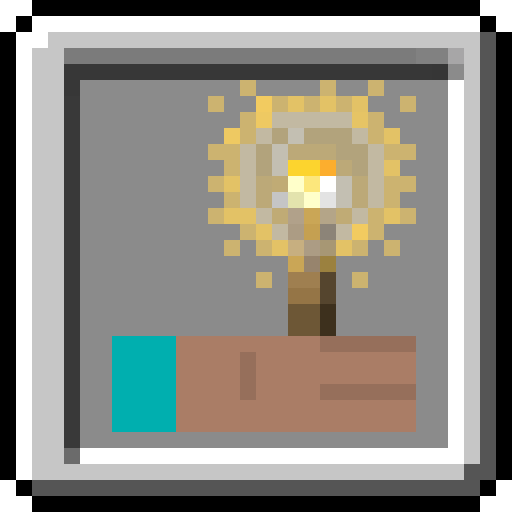

<!-- PROJECT BADGES -->

![Version][version-badge]
[![Stars][stars-badge]][stars-url]
[![License][license-badge]][license-url]

<!-- PROJECT LOGO -->
 

  
  <h3>FlashLight</h3>
  

    An plugin that make glowing when holding light source!

[Contact to me][author-discord] · [Report a bug][issues-url] · [Request a feature][issues-url]

  

<!-- ABOUT THE PROJECT -->

## About The Project

![Project Preview][project-preview]

:heavy_check_mark: Make glowing when holding light source!    
:heavy_check_mark: You can configure the update delay and item light levels in `config.yml`

Just holding a glowing block like `torch`, The surroundings become brighter.
> Primarily useful for navigating dark places with torches.

##

-----

## TODO:

- [ ] Supports configuration modification via command
- [ ] Supports off-hand (left hand)
- [ ] Supports items that do not have a block

##

-----

## Installation & Requirements

- **Server**
  - [axolotl-pm/PocketMine-MP](https://github.com/axolotl-pm/PocketMine-MP) `5.51` or higher (`plugin.yml` `api: [5.51.0]`),
    which uses BedrockProtocol 64 (Bedrock `1.26.60`).
  - PHP `8.4` or higher.
- **Installation**
  1) Download `Flashlight.phar` from [GitHub Releases][releases-url]
  2) Move the downloaded `.phar` file to the server's **/plugins/** folder
  3) Restart the server
- **Old versions**
  - The version for the original [pmmp/PocketMine-MP](https://github.com/pmmp/PocketMine-MP) `5.x` is kept on
    the [`legacy/pmmp-5.44`](https://github.com/presentkim-pm/FlashLight/tree/legacy/pmmp-5.44) branch.
- **Development**
  - `composer install` then `composer test` runs the PHPUnit tests, which encode the packets the plugin sends with
    the real BedrockProtocol serializer.

##

-----

## Configuration

`plugins/Flashlight/config.yml` is created on the first start.

| Key                 | Default | Description                                                                                                       |
|---------------------|---------|-------------------------------------------------------------------------------------------------------------------|
| `update-delay`      | `0.25`  | Seconds between light updates. Higher = less CPU, lower = the light follows the player faster.                    |
| `item-light-levels` | `lava_bucket: 15` | Light level (`0`-`15`) of items that are not calculated automatically, such as a lava bucket or custom items. Item names are the same as for `/give`. |

##

-----

## License

Distributed under the **LGPL 3.0**. See [LICENSE][license-url] for more information

##

-----

[author-discord]: https://discordapp.com/users/345772340279508993

[version-badge]: https://img.shields.io/github/v/release/presentkim-pm/FlashLight?display_name=tag&style=for-the-badge&label=VERSION

[release-badge]: https://img.shields.io/github/downloads/presentkim-pm/FlashLight/total?style=for-the-badge&label=GITHUB%20

[stars-badge]: https://img.shields.io/github/stars/presentkim-pm/FlashLight.svg?style=for-the-badge

[license-badge]: https://img.shields.io/github/license/presentkim-pm/FlashLight.svg?style=for-the-badge

[stars-url]: https://github.com/presentkim-pm/FlashLight/stargazers

[releases-url]: https://github.com/presentkim-pm/FlashLight/releases

[issues-url]: https://github.com/presentkim-pm/FlashLight/issues

[license-url]: https://github.com/presentkim-pm/FlashLight/blob/main/LICENSE

[project-icon]: https://raw.githubusercontent.com/presentkim-pm/FlashLight/main/assets/icon.png

[project-preview]: https://raw.githubusercontent.com/presentkim-pm/FlashLight/main/assets/preview.gif
